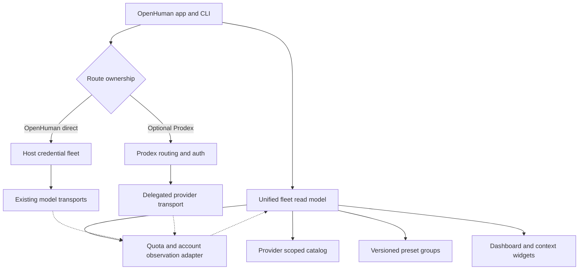

# Second-order convergence: domain authority instead of module accumulation

The first pass yields a catalog, quota snapshot, advisory direct fleet, preset editor/sync, refresh gate and UI-ready summaries. The second-order result is **not** another gateway: it is one top-level model-fleet view and a set of authority boundaries. `convergence.mjs` now composes the first-order primitives into a redacted, provider-scoped read model and leaves credential execution to the existing host or explicitly delegated gateway.

## Ownership matrix

| Domain decision | Single owner | Other consumers | Explicit invariant |
|---|---|---|---|
| Credentials and refresh tokens | Existing OpenHuman secure backend/keychain, or delegated Prodex gateway | UI read model, quota probe | Never pass secret material through `peer-fleet` DTOs or renderer |
| Direct-provider account selection | OpenHuman direct-key runtime | Dashboard, quota, CLI | Exactly one selector, one retry policy, one in-flight counter per request |
| Delegated Prodex model/key selection | Prodex gateway | Host catalog and diagnostics | No double rotation, reattempt or billing across gateway boundaries |
| Live model availability/limits/pricing | Authenticated provider or configured gateway runtime | Static catalog declarations and UI | Offline source metadata cannot prove availability, capability or free pricing |
| Per-account quota observations | Provider-specific host adapter | Normalizer, time series, charts, scheduler | Reject stale overwrites and invalid data; never infer missing quota is 100% |
| App/IDE file mutation and process control | Native desktop host | UI action confirmation | No unsupervised terminal/CDP actions or automatic state injection |
| Endpoint and preset metadata | Host config persistence | `presets.mjs` and UI | Revisioned transactional edits; secrets in native vault, URLs validated |
| Event and request lifecycle | Runtime request tracker | Advisory fleet and telemetry | Lease idempotence; never retry after response commit; no duplicate charge |

## Architecture diagram

### Higher-order capabilities recommended for actual host integration

1. **Provenance ledger:** One typed `ModelEvidence` tuple `(provider, modelId, accountScope, source, observedAt, expiryAt)`. Declarations and live provider evidence must never be mixed in the same trust level. Compatible with model alias/provider presets from all four peers.
2. **Fleet capability planner:** Join verified model availability, per-window quota health, endpoint preset groups and gateway ownership **before** starting a request. The independent `recommendModelRoute` is a pure, credential-free implementation of the planning half; the executor belongs to the host.
3. **Quota event ledger:** Append-only reset-aware consumption observations, stale-revision conflict arbitration, bounded history and privacy-safe aggregation. Source ideas from Panel/Shield/SwitchAI; persistence and UI hooks still require actual OpenHuman source.
4. **Protocol fidelity suite:** Feed the same semantic requests to existing OpenHuman adapters and independently reviewed peer mappers; verify request/response parity for tools, thinking, streaming, image, audio, video, errors and deferred Responses. Do not replace mature transport with peer wrappers until parity is demonstrated.
5. **Native recovery and security boundary:** Secure keyring, atomic backup, safe session restoration and OS-specific process adapters, with opt-in privilege gates, revocable approvals and no credential exposure in frontend IPC.
6. **Accessible, responsive fleet workspace:** One set of normalized quota/status/chart DTOs powering account grid/table, model/preset editor, health/latency panel, token heatmap, context gauge and tray/status indicators. Needs React/Tauri frontend integration and visual/runtime QA.

### Source-peer supersession decisions

- Prefer SwitchAI's conservative snapshot/revision controls over blindly accepting later-arriving API responses; prefer Panel's context and reset-aware history semantics over static quotas; prefer Shield's account-scoped 403/429 *classification* over banning an account for an undifferentiated HTTP code; prefer native OpenHuman/Prodex routing ownership over copying Shield's complete proxy pool; prefer ZeroGravity's measurable request lifecycle *concepts* without transporting its privileged MITM/LS impersonation architecture.
- Treat separate `model_specs.json`, Shield React model config, Panel quota group JSON and ZeroGravity protobuf enum models as overlapping declarations, **not interchangeable live model registries**. The pinned extracted catalog is purposefully unverified and provider-scoped.
- UI state, provider identity, credential storage and transport details are not the same layer: deduplicate *contracts* and telemetry, not all similar-looking code. Two unit test functions with identical bodies can be valuable separate layer assertions.

### Acceptance gates before shipping an actual PR

1. Connected fork/PR source and latest commits fetched; CodeRabbit threads inventoried, mapped to changes and resolved only after evidence.
2. Build OpenHuman Rust workspace, CLI and Tauri app using repository-pinned toolchain; run its own unit/integration/E2E suites.
3. Audit provider route/secret ownership and the full live subscription/account flows; verify no duplicate model profiles, key pools or stale event races.
4. Test real-time model discovery and multimodal/tool streaming against consenting accounts and nonprivileged API keys; make capability and pricing claims only when runtime-verified.
5. Run account-switch/recovery in cross-platform sacrificial test profiles; ensure backups, rollback, permissions, crash repair and privacy.
6. Run responsive/accessibility/keyboard contrast and RTL tests on the actual UI (mobile/tablet/desktop); ensure no unhandled network errors surfaced as raw logs.
7. Re-run CI after actual push, fix all failures, and only then resolve CodeRabbit review threads and report merge readiness.

This document is an integration boundary and a source-backed follow-up, **not a claim that these host-level acceptance gates are complete**.
